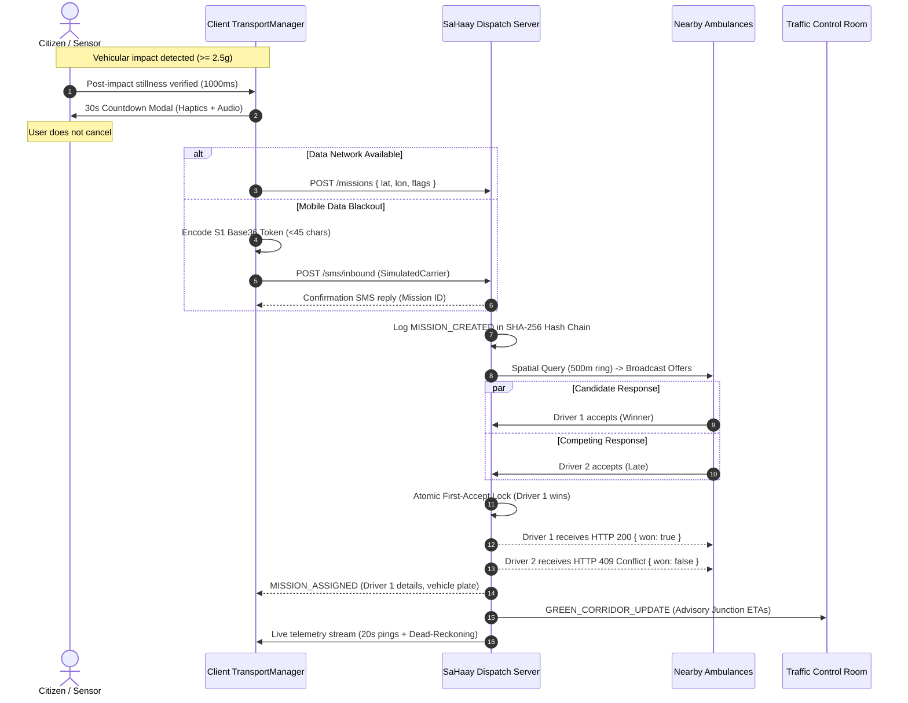
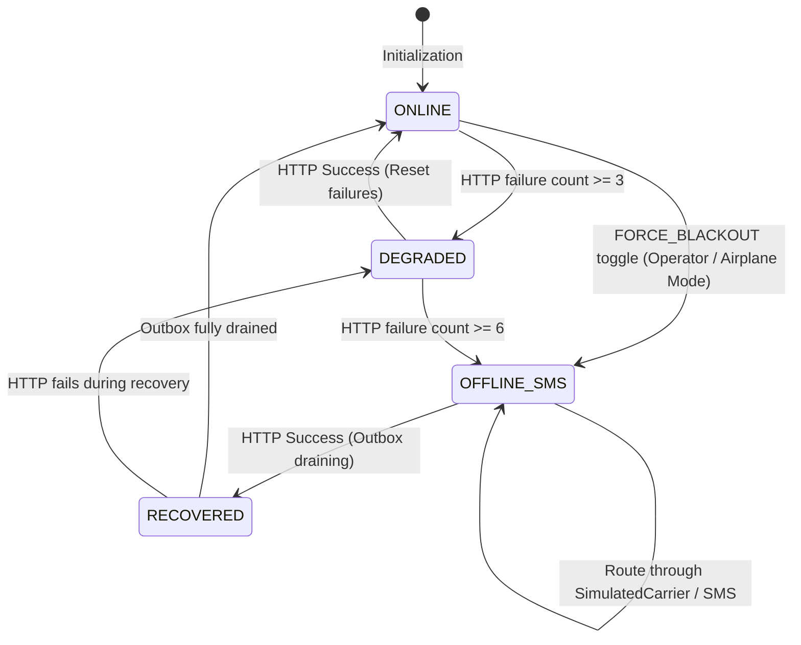

# SaHaay — System Architecture & Technical Specification

## 1. High-Level System Architecture

SaHaay operates as an autonomous, offline-first emergency coordination layer. It decouples the dispatch decision loop from human call centres while maintaining continuous communication over hybrid WebSockets and GSM/SMS channels.

```mermaid
graph TB
    subgraph "Edge Tier (Citizen / IoT)"
        Sensor[Accelerometer Sensor] --> Detector[CrashDetector (Stillness Filter)]
        Detector --> Countdown[30s Safety Countdown Timer]
        Countdown --> SOS[SOS Trigger]
        Manual[Manual SOS Button] --> SOS
        SOS --> TransportMgr[TransportManager State Machine]
    end

    subgraph "Dual Transport Pipelines"
        TransportMgr -- Online --> HTTP[REST / WebSocket Gateway]
        TransportMgr -- Offline (Blackout) --> SMS[Base36 SMS Codec]
        SMS -.-> Carrier[GSM Telephony / SimulatedCarrier]
    end

    subgraph "SaHaay Core Dispatch Engine (Node / TypeScript)"
        Carrier --> SMSInbound["/sms/inbound Webhook"]
        HTTP --> MissionCtrl[Mission Controller]
        SMSInbound --> MissionCtrl
        
        MissionCtrl --> Grid[In-Memory Spatial Binning Grid]
        Grid --> Ripple[Ripple Search Ladder: 500m -> 8km]
        Ripple --> Offers[Driver Offer Dispatch]
        
        Offers --> Lock["Synchronous First-Accept Lock (Atomic)"]
        Lock --> ActiveMission[Active Mission Lifecycle]
        
        ActiveMission --> DeadReckoning[Dead-Reckoning Marker Engine]
        ActiveMission --> GreenCorridor[Green Corridor Advisory Alert]
        ActiveMission --> Breakdown[Breakdown Anomaly Handler]
        
        Breakdown -- Redispatch to Live GPS --> Ripple
        
        MissionCtrl --> AuditChain["SHA-256 Tamper-Evident Hash Chain"]
    end

    subgraph "Operational Dashboards"
        GreenCorridor --> ControlUI["/control Dashboard (Traffic Authorities)"]
        AuditChain --> AuditUI["Audit Verification / Tamper Demo"]
        DeadReckoning --> TelemetryStream[WebSocket Telemetry Stream]
    end
```

---

## 2. Emergency SOS Sequence Diagram



---

## 3. Transport State Machine



---

## 4. Self-Healing Failover Sequence

```mermaid
sequenceDiagram
    autonumber
    actor Patient as Citizen (Live GPS)
    participant Stranded as Stranded Ambulance
    participant Server as Dispatch Server
    participant Fleet as Fleet Spatial Index

    Note over Stranded: Mechanical breakdown reported
    Stranded->>Server: POST /missions/:id/breakdown { ambulanceId }
    Server->>Server: Mark Stranded status = 'BREAKDOWN'
    Server->>Server: Log stranded coordinates for crew recovery in SHA-256 ledger
    
    Server->>Patient: Alert: Breakdown occurred; replacement on route
    
    Note over Server, Patient: Search restarts from PATIENT'S LIVE GPS
    Server->>Fleet: Query nearest available from patientLatLive, patientLonLive
    Fleet->>Server: Replacement Ambulance confirms
    Server->>Patient: Assignment updated with Replacement unit
    Server->>Server: Audit event: REDISPATCH_ASSIGNED
```

---

## 5. Offline Mapping & Vector Tile Strategy

### Prototype Implementation (Bundled GeoJSON + Turf.js)
1. **Zero-Dependency Bundle:** Bundled `assets/ahmedabad-roads.geojson` (<1.5 MB) provides the arterial road network for Ahmedabad, explicitly marked `synthetic: true`.
2. **Dead-Reckoning Projection:** Between low-frequency GPS/SMS updates ($20\text{s}$ interval), the `DeadReckoningTracker` advances the ambulance icon along road coordinates (`@turf/along`) or project heading (`@turf/destination`).
3. **Smooth Exponential Filtering:** A smoothing filter ($\tau = 0.7\text{s}$) prevents visual snaps when fresh fixes arrive.

### Production Roadmap (Native Vector Tiles)
1. **MapLibre Native / Protomaps:** Deploy on-device vector basemaps using offline `.pmtiles` or `.mbtiles` packages containing the regional road extract.
2. **Turn-by-Turn Companion Navigation:** Driver application delegates to **Organic Maps** or system navigation via standard `geo:` URI deep links, avoiding heavy embedded routing libraries.
