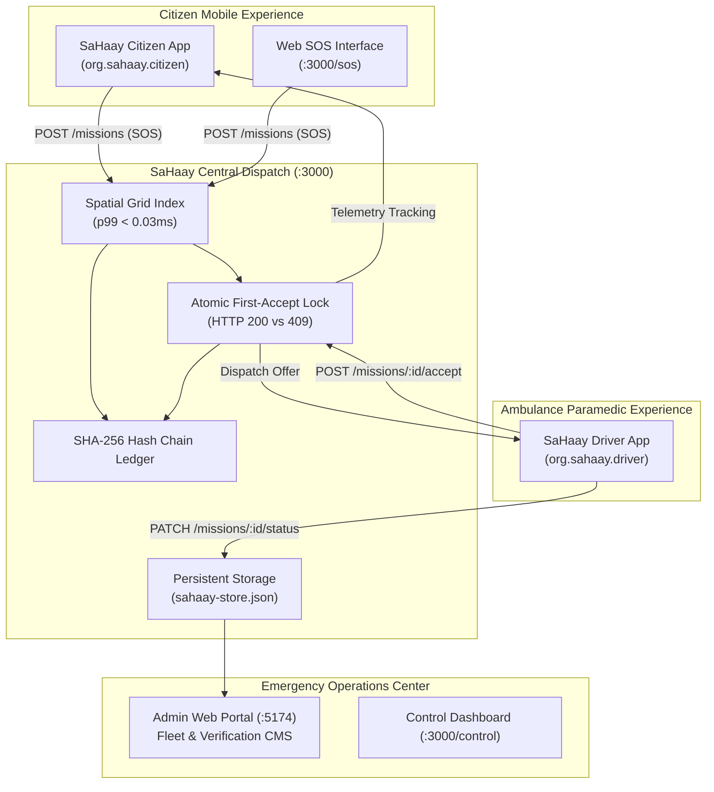

# SaHaay: India's First Autonomous Emergency Response Grid


[](https://github.com/Ahad-Dngwala/SaHaay-2k26/actions/workflows/sahaay-ci.yml)
[](LICENSE.md)

-red?style=for-the-badge)


> **"No patient left waiting."**
>
> SaHaay transforms emergency response from an opaque manual coordination process into a **real-time, data-driven, offline-first ecosystem** comprising two standalone native Android APKs, a central web admin portal, and an authoritative low-latency dispatch engine.
>
> 📖 **Judges & Evaluators:** See [docs/PROTOTYPE_GUIDE.md](docs/PROTOTYPE_GUIDE.md) for the complete end-to-end user journey demonstration script and system architecture.

---

## 📉 The Critical Gap

In the Golden Hour, certainty saves lives. Yet, India's current emergency infrastructure (108/112) relies on manual call-centre coordination, leading to fatal delays, untracked routes, and zero recovery when an ambulance breaks down.

| Current System (108/112) ❌ | SaHaay Autonomous Grid ✅ |
| :--- | :--- |
| **Manual Dispatch** via Call Centers | **Instant Proximity Dispatch** ($p99 = 0.025\text{ ms}$ search latency) |
| **Blind Waiting** (No Tracking) | **Live Tracking with Dead-Reckoning** |
| **Single Point of Failure** | **Self-Healing Failover** (Auto-Redispatch to Patient Live GPS) |
| **Network Dependent** | **Offline SMS-First Mechanism** ($\le 45$ char Base36 packets) |
| **Opaque Operations** | **Cryptographic SHA-256 Audit Trail** |

---

## 🏗️ Autonomous Ecosystem Architecture

SaHaay operates as a unified emergency response ecosystem:

1. **SaHaay Citizen Android App (`org.sahaay.citizen`)**: Tactile hold-to-confirm SOS, automatic 30s crash countdown, approaching ambulance live telemetry, and official government safety alerts.
2. **SaHaay Ambulance Driver Android App (`org.sahaay.driver`)**: State paramedic verification gate, on-duty radar dome, atomic mission acceptance, turn-by-turn navigation stages, and breakdown reporting.
3. **SaHaay Central Admin Portal (`apps/admin-web/`)**: Public verified APK download center, real-time fleet overview, driver license verification queue, emergency dispatch monitor, and official advisories CMS.
4. **Authoritative Dispatch Server (`server/`)**: Sub-millisecond spatial cell hashing, synchronous first-accept lock, WebSocket broadcast, file-backed persistence, and tamper-evident SHA-256 audit ledger.



---

## 🔥 Key Capabilities

### 1. ⚡ High-Performance Dispatch Engine ($< 0.03\text{ ms}$ search latency)
- **In-Memory Spatial Grid Index**: Uses fixed $0.01^\circ$ (~1.11 km) spatial cell hashing to index thousands of ambulances.
- **Empirically Measured Benchmark**: Measured with `npm run bench` (1,000 iterations per radius):
  - **1,000 ambulances**: $p50 = 6.2\ \mu\text{s}$, $p99 = 0.049\text{ ms}$ at $1.0\text{ km}$.
  - **10,000 ambulances**: $p50 = 9.0\ \mu\text{s}$, $p99 = 0.025\text{ ms}$ at $500\text{ m}$.
  - *Full benchmark report: [docs/BENCHMARK.md](docs/BENCHMARK.md)*.
- **Synchronous First-Accept Lock**: Atomically locks assignment on the first driver acceptance (HTTP 200); any competing or late acceptances receive **HTTP 409 Conflict** and are cancelled.
- **Targeted Driver Dispatch & Fast Ring Expansion**: Offers are dispatched directly to the eligible driver's device via authenticated WebSocket (`sendToAmbulance`) or push notification. Configurable TTL timers handle progressive ripple ring expansion (500m $\to$ 8km) if a unit declines or times out.

### 2. 🛡️ Self-Healing Failover (Breakdown Protection)
- When a breakdown is reported for an active ambulance:
  - The vehicle is transitioned to `BREAKDOWN` and its stranded coordinates are logged in the SHA-256 audit ledger for crew recovery.
  - The dispatch system **automatically restarts search from the patient's LIVE GPS coordinates** (not the stranded vehicle's location).
  - No human call-centre intervention required.

### 3. 📡 Disaster-Ready Offline Mode (DIL)
- **Ultra-Compact Base36 SMS Protocol**:
  - Format: `S1|<uid36>|<lat36>|<lon36>|<ts36>|<addrId36>|<flags36>|<crc8>`
  - Encodes 1-metre GPS precision in **under 45 characters** (safe within 160-char GSM-7 limit).
  - Strict boundary checking on encoding (latitude $[-90, 90]$, longitude $[-180, 180]$).
  - Includes a 2-char Base36 address hint from a bundled 200-locality Ahmedabad gazetteer (`assets/gazetteer.json`).
  - Protected with a polynomial CRC-8 checksum (`0x07`).
- **Deterministic 4-State Transport Machine**: `ONLINE` $\to$ `DEGRADED` $\to$ `OFFLINE_SMS` $\to$ `RECOVERED` with an asynchronous outbox queue and exponential backoff.

### 4. 💥 Intelligent Crash Detection & Countdown Safety
- Continuously polls accelerometer ($20\text{ ms}$ interval, $50\text{ Hz}$).
- Requires $\ge 2.5\text{ g}$ sustained impact for $\ge 100\text{ ms}$, followed by a $1000\text{ ms}$ post-impact stillness filter ($\Delta g < 0.3\text{ g}$).
- Prevents false triggers from potholes, sharp braking, and phone drops.
- **30-Second Safety Countdown**: Defaults to 30 seconds (`COUNTDOWN_SEC = 30`), configurable 5–30s. Cancellation guarantees zero SOS emissions; countdown completion triggers exactly one SOS.

### 5. 🔐 Tamper-Evident SHA-256 Audit Chain
- Cryptographic hash chain: each log entry hashes the previous hash, timestamp, event, and data payload.
- Real-time verification via `GET /audit/verify`.
- Includes a live tamper demonstration API (`POST /audit/tamper`) to prove mathematical integrity to judges.

---

## 🛠️ Technology Stack

| Layer | Component | Technology |
| :--- | :--- | :--- |
| **Server** | Dispatch Engine & WebSocket | **Node.js, Express, ws, TypeScript** |
| **Persistence** | File-backed State Store | **JSON Store (`server/data/sahaay-store.json`)** |
| **Core Logic** | Codec, State Machine, Sensors | **Pure TypeScript** (Single source of truth in `src/core/config.ts`) |
| **Spatial Index** | Proximity Matching | **Spatial Cell Hashing Grid + Haversine** |
| **Audit Trail** | Tamper-Evident Ledger | **SHA-256 Cryptographic Hash Chain** |
| **Citizen App** | Standalone Native APK | **Android (Java 8 / SDK 34) + Offline Web App (`org.sahaay.citizen`)** |
| **Driver App** | Standalone Native APK | **Android (Java 8 / SDK 34) + Offline Web App (`org.sahaay.driver`)** |
| **Admin Web** | Central Operations Portal | **React, Vite, Tailwind CSS (`apps/admin-web/`)** |

---

## 🚀 Quick Start (Zero-Config Runner)

No cloud accounts, no API keys, and no external database required.

### 1. Install Dependencies
```bash
git clone https://github.com/Ahad-Dngwala/SaHaay-2k26.git
cd SaHaay-2k26
npm install
```

### 2. Start the Dispatch Server & Control Dashboard
```bash
npm run dev:server
```
- **Control Dashboard:** [http://localhost:3000/control](http://localhost:3000/control)
- **Citizen SOS Web Interface:** [http://localhost:3000/sos](http://localhost:3000/sos)
- **Health Endpoint:** [http://localhost:3000/health](http://localhost:3000/health)

### 3. Start the Admin Web Portal
```bash
cd apps/admin-web
npm run dev
```
- Accessible at [http://localhost:5174](http://localhost:5174)
- Admin Login: `admin@sahaay.gov.in` / `SaHaayAdmin2026!`

### 4. Build Standalone Android APKs
```powershell
powershell -ExecutionPolicy Bypass -File scripts/build-apk.ps1
```
Output signed release APKs:
- `artifacts/apk/SaHaay-Citizen.apk`
- `artifacts/apk/SaHaay-Driver.apk`

### 5. Run Quality, Build & Verification Commands
```bash
npm run typecheck    # Verifies TypeScript compiler across core and server (0 errors)
npm run build:server # Builds production server to dist/
npm test             # Runs test suite locally (87 tests across 12 suites)
npm run test:smoke   # Cross-platform runtime smoke test
npm run bench        # Spatial grid benchmark (<200ms assertion on 10k fleet)
```

---

## 🏆 Project Status

- [x] **Single Source of Truth (`src/core/config.ts`)**
- [x] **Compact Base36 SMS Codec with CRC8 & Bounds Checking (`src/core/sosCodec.ts`)**
- [x] **In-Memory Spatial Index Matching (`server/src/matching.ts`)**
- [x] **Synchronous First-Accept Lock with HTTP 409 Conflict (`server/src/dispatch.ts`)**
- [x] **Dynamic Ripple Search Ladder (500m $\to$ 8km)**
- [x] **Empirical Benchmark Suite (`docs/BENCHMARK.md`: $0.025\text{ ms}$ search latency)**
- [x] **Vehicular Crash Detector with Stillness Filter (`src/core/crash/CrashDetector.ts`)**
- [x] **30-Second Countdown Timer with Cancel & Exactly-Once SOS (`src/core/crash/CountdownTimer.ts`)**
- [x] **Deterministic Transport State Machine (`src/core/transport/TransportManager.ts`)**
- [x] **Cryptographic Tamper-Evident Audit Chain (`server/src/audit.ts`)**
- [x] **Self-Healing Failover to Live Patient GPS with Breakdown Coordinates Preserved**
- [x] **Two Separate Standalone Signed Android APKs (`SaHaay-Citizen.apk`, `SaHaay-Driver.apk`)**
- [x] **Central Public Portal & Authenticated Control Room (`apps/admin-web/`)**
- [x] **87 / 87 Automated Tests Passing across 12 Test Suites**
- [x] **Zero TypeScript Errors (`npx tsc --noEmit`) and Zero Reality-Check Violations**
- [x] **Real OSRM Road Routing Engine with Dynamic Nearest-Hospital Selection**
- [x] **Real Background Crash Detection Foreground Service with Quick Settings Tile**
- [x] **Real Route-Snapping Green Corridor Advisory Pre-Clearance (20 Ahmedabad Junctions)**
- [x] **Native Android GSM-7 Base36 SMS Receiver & Driver Gateway Blackout Fallback**
- [x] **19/19 Android Deprecations & Lints Cleaned Across Native App Codebases**

---

> Made with ❤️ by Team SECRET CODERS. **Built for India.** Saving lives, one millisecond at a time.
