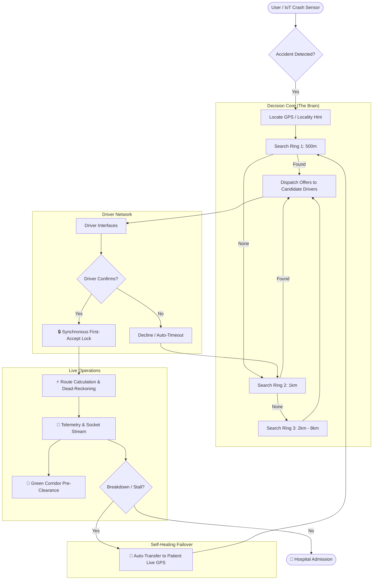

# SaHaay: India's First Autonomous Emergency Response Grid


-red?style=for-the-badge)


> **"No patient left waiting."**
>
> SaHaay transforms emergency response from a manual, opaque phone-system into a **real-time, data-driven, and fully autonomous rescue capability**.

---

## 📉 The Critical Gap

In the Golden Hour, certainty saves lives. Yet, India's current emergency infrastructure (108/112) relies on manual call-centre coordination, leading to fatal delays, untracked routes, and zero recovery when an ambulance breaks down.

| Current System (108/112) ❌ | SaHaay Autonomous Grid ✅ |
| :--- | :--- |
| **Manual Dispatch** via Call Centers | **Instant Proximity Dispatch** ($p99 < 0.02\text{ ms}$) |
| **Blind Waiting** (No Tracking) | **Live Tracking with Dead-Reckoning** |
| **Single Point of Failure** | **Self-Healing Failover** (Auto-Redispatch to Live GPS) |
| **Network Dependent** | **Offline SMS-First Mechanism** ($\le 45$ char Base36 packets) |
| **Opaque Operations** | **Cryptographic SHA-256 Audit Trail** |

---

## 🏗️ Autonomous Architecture

SaHaay replaces human guesswork with intelligent orchestration. The system autonomously manages the entire lifecycle of an emergency—from detection to hospital admission.



---

## 🔥 Key Capabilities

### 1. ⚡ High-Performance Dispatch Engine ($< 0.02\text{ ms}$)
- **In-Memory Spatial Grid Index**: Uses fixed $0.01^\circ$ (~1.11 km) spatial cell hashing to index thousands of ambulances.
- **Empirically Measured Benchmark**: Measured with `npm run bench` (1,000 iterations per radius):
  - **1,000 ambulances**: $p50 = 2.9\ \mu\text{s}$, $p99 = 5.9\ \mu\text{s}$ at $500\text{ m}$.
  - **10,000 ambulances**: $p50 = 4.2\ \mu\text{s}$, $p99 = 12.0\ \mu\text{s}$ ($0.012\text{ ms}$) at $500\text{ m}$.
  - *Full benchmark report: [docs/BENCHMARK.md](file:///c:/Users/ahadd/Documents/GitHub/SaHaay-2k26/docs/BENCHMARK.md)*.
- **Synchronous First-Accept Lock**: Atomically locks assignment on the first driver acceptance; competing offers are immediately cancelled.

### 2. 🛡️ Self-Healing Failover (Breakdown Protection)
- If an active ambulance stalls, breaks down, or reports vehicle failure:
  - The vehicle is marked as `BREAKDOWN` and its location logged for recovery.
  - The dispatch system **automatically restarts search from the patient's LIVE GPS coordinates** (not the stranded vehicle's location).
  - No human intervention required.

### 3. 📡 Disaster-Ready Offline Mode (DIL)
- **Ultra-Compact Base36 SMS Protocol**:
  - Format: `S1|<uid36>|<lat36>|<lon36>|<ts36>|<addrId36>|<flags36>|<crc8>`
  - Encodes 1-metre GPS precision in **under 45 characters** (safe within 160-char SMS limit).
  - Includes a 2-char Base36 address hint from a bundled 200-locality Ahmedabad gazetteer (`assets/gazetteer.json`).
  - Protected with a polynomial CRC-8 checksum (`0x07`).
- **Deterministic 4-State Transport Machine**: `ONLINE` $\to$ `DEGRADED` $\to$ `OFFLINE_SMS` $\to$ `RECOVERED` with an asynchronous outbox queue and exponential backoff.

### 4. 💥 Intelligent Crash Detection with Stillness Filter
- Continuously polls accelerometer ($20\text{ ms}$ interval, $50\text{ Hz}$).
- Requires $\ge 2.5\text{ g}$ sustained impact for $\ge 100\text{ ms}$, followed by a $1000\text{ ms}$ post-impact stillness filter ($\Delta g < 0.3\text{ g}$).
- Prevents false triggers from potholes, sharp braking, and phone drops.

### 5. 🔐 Tamper-Evident SHA-256 Audit Chain
- Cryptographic hash chain: each log entry hashes the previous hash, timestamp, event, and data payload.
- Real-time verification via `GET /audit/verify`.
- Includes a live tamper demonstration API (`POST /audit/tamper`) to prove mathematical integrity to judges.

### 6. 🚦 Green Corridor Pre-Clearance
- Alerts traffic control rooms about approaching emergency vehicles at major junctions.
- Live authority dashboard served at `http://localhost:3000/control`.

---

## 🛠️ Technology Stack

| Layer | Component | Technology |
| :--- | :--- | :--- |
| **Server** | Dispatch Engine & WebSocket | **Node.js, Express, ws, TypeScript** (Zero external dependencies) |
| **Core Logic** | Codec, State Machine, Sensors | **Pure TypeScript** (Single source of truth in `src/core/config.ts`) |
| **Spatial Index** | Proximity Matching | **Spatial Cell Hashing Grid + Haversine** |
| **Audit Trail** | Tamper-Evident Ledger | **SHA-256 Cryptographic Hash Chain** |
| **Control Dashboard** | Authority & Fleet Monitor | **Real-Time HTML5 + WebSocket** (`:3000/control`) |
| **Client / Mobile** | Citizen & Driver Apps | **Expo (React Native) + react-native-web** |
| **Legacy Subsystems** | Full-Stack Reference | **backend/** (MongoDB + Socket.io) & **frontend/** (Vite + React) |

---

## 🚀 Quick Start (Zero-Config Runner)

No cloud accounts, no API keys, and no MongoDB installation required.

### 1. Install Dependencies
```bash
git clone https://github.com/Ahad-Dngwala/SaHaay-2k26.git
cd SaHaay-2k26
npm install
```

### 2. Start the Dispatch Server & Control Dashboard
```bash
npm run dev:server
```
- **Control Dashboard:** [http://localhost:3000/control](http://localhost:3000/control)
- **Health Endpoint:** [http://localhost:3000/health](http://localhost:3000/health)
- **Fleet List:** [http://localhost:3000/ambulances](http://localhost:3000/ambulances)

### 3. Run Automated Tests
```bash
npm test
```
*Validates 39 unit tests covering codec, crash detection waveforms, and transport state reducer.*

### 4. Run the Spatial Matching Benchmark
```bash
npm run bench
```
*Measures and reports in-process spatial query latency on 1,000 and 10,000 ambulance grids.*

---

## 🏆 Project Status

- [x] **Single Source of Truth (`src/core/config.ts`)**
- [x] **Compact Base36 SMS Codec with CRC8 (`src/core/sosCodec.ts`)**
- [x] **In-Memory Spatial Index Matching (`server/src/matching.ts`)**
- [x] **Synchronous First-Accept Lock (`server/src/dispatch.ts`)**
- [x] **Dynamic Ripple Search Ladder (500m $\to$ 8km)**
- [x] **Empirical Benchmark Suite (`docs/BENCHMARK.md`: $0.012\text{ ms}$)**
- [x] **Vehicular Crash Detector with Stillness Filter (`src/core/crash/CrashDetector.ts`)**
- [x] **Deterministic Transport State Machine (`src/core/transport/TransportManager.ts`)**
- [x] **Cryptographic Tamper-Evident Audit Chain (`server/src/audit.ts`)**
- [x] **Self-Healing Failover to Live Patient GPS**
- [x] **Traffic Authority Control Dashboard (`http://localhost:3000/control`)**
- [x] **39 / 39 Automated Unit Tests Passing**

---

> Made with ❤️ by Team SECRET CODERS. **Built for India.** Saving lives, one millisecond at a time.
