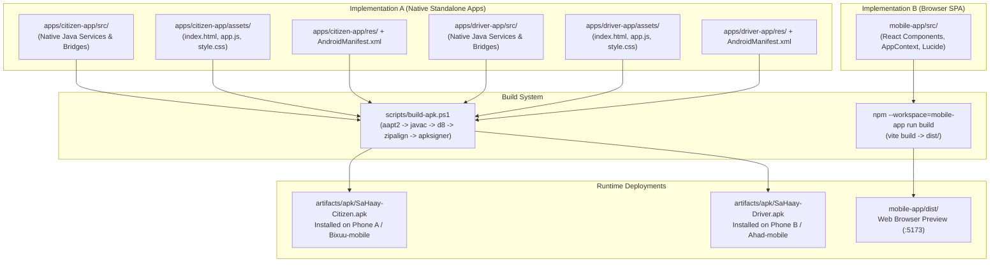

# Mobile Runtime Map — SaHaay Ecosystem

**Document:** `docs/MOBILE_RUNTIME_MAP.md`  
**Purpose:** Reconcile and establish the canonical relationship between the two divergent mobile implementations in the repository.

---

## 1. Executive Architecture Summary

The repository contains two distinct mobile codebases with different runtime models, build pipelines, and packaging targets:

1. **Implementation A: Standalone Native Android Applications**
   - Locations: [`apps/citizen-app/`](../apps/citizen-app/) and [`apps/driver-app/`](../apps/driver-app/)
   - Nature: Native Android Java applications hosting focused WebView shells and native Android foreground services.
   - Deliverables: Two distinct, separately buildable, separately signable, and separately installable APKs:
     - `artifacts/apk/SaHaay-Citizen.apk` (`org.sahaay.citizen`)
     - `artifacts/apk/SaHaay-Driver.apk` (`org.sahaay.driver`)
   - Native Capabilities:
     - Android Foreground Service with Partial WakeLock (`CrashMonitorService`)
     - System Quick Settings Tile (`CrashTileService`)
     - Android Boot Autostart (`BootReceiver`)
     - GSM Broadcast SMS Receiver (`SmsReceiver` with `Telephony.Sms.Intents`)
     - Native JavaScript Bridges (`SaHaayCitizenBridge`, `SaHaayDriverBridge`)
     - Hardware GPS and Sensor access via Android SDK 34 APIs

2. **Implementation B: Unified Vite/React Web Application**
   - Location: [`mobile-app/`](../mobile-app/)
   - Nature: Single-Page Application (SPA) built with React 18, Vite, and Tailwind CSS.
   - Deliverable: Client-side web bundle running in desktop/mobile web browsers at `http://localhost:5173`.
   - Role Management: Contains a `RoleSwitcherPill` switching between citizen and driver views inside a single session.
   - Current Deficiencies: Contained historical simulated fallbacks (`quickAssign` timeout after 2.5s, hardcoded `defaultDriver = 'ambu-402'`, fake SVG map without real tiles, and synthetic offline fallbacks in `api.ts`).

---

## 2. Directory to Artifact Build Mapping

### Critical Findings:
- **What is actually installed on test devices:** When running `adb install artifacts/apk/SaHaay-Citizen.apk` and `SaHaay-Driver.apk`, the devices execute **Implementation A** (`apps/citizen-app/assets` and `apps/driver-app/assets`).
- **Isolation:** `mobile-app/` is **never** copied, bundled, or dexed into `SaHaay-Citizen.apk` or `SaHaay-Driver.apk`. Changes made only to `mobile-app/` have zero effect on the Android APKs.
- **Divergence Risk:** Previous iterations maintained parallel implementations where features were added to `mobile-app` without being reflected in `apps/*/assets`, or where hardcoded polling loops persisted in `apps/driver-app/assets/app.js`.

---

## 3. Authoritative Architectural Decision

### Canonical Mobile Runtime: Implementation A (`apps/citizen-app` and `apps/driver-app`)
To adhere strictly to the foundational architectural requirement of **two separate, installable, authenticated native APKs for Citizen and Driver** running real sensors, background foreground services, and Quick Settings tiles:

1. **`apps/citizen-app` and `apps/driver-app` are the authoritative mobile applications of the SaHaay ecosystem.**
2. All real-device integration, authenticated WebSockets, targeted driver offer handling, real map tile rendering, and native hardware sensor listening are implemented and verified in `apps/citizen-app/` and `apps/driver-app/`.
3. Any edits to mobile HTML, JavaScript, and CSS are made directly in:
   - `apps/citizen-app/assets/`
   - `apps/driver-app/assets/`
   and packaged into APKs via `scripts/build-apk.ps1`.
4. `mobile-app/` is retained strictly as a browser-based multi-role companion preview, but all fake quick-assignments, fabricated network success responses, and hardcoded identities are expunged to prevent architectural drift.
