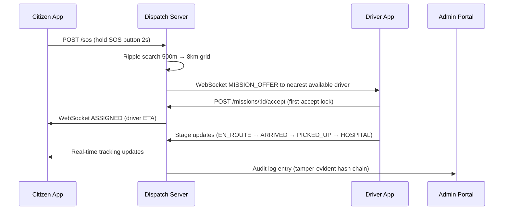

# SaHaay Prototype Guide — Hack for Social Cause 2027

**Document:** `docs/PROTOTYPE_GUIDE.md`  
**Last Updated:** 2026-10-31  
**Milestone:** M11 (Final Audit)

---

## §8.1 — What SaHaay Is

SaHaay ("help" in Gujarati/Hindi) is an **offline-first emergency ambulance dispatch system** built for India, targeted at the **Healthcare, Wellbeing & Service Delivery** theme of Hack for Social Cause 2027.

### The Problem
When someone calls 108 (India's ambulance helpline), they often wait 8–12 minutes for dispatch acknowledgement alone. In urban corridors like Ahmedabad, poor mobile coverage makes tracking impossible. SMS-only fallback devices exist but have no standard dispatch protocol.

### The Solution

| Component | Role |
|---|---|
| **Citizen Android App** (`SaHaay-Citizen.apk`) | Tactile SOS button, live ambulance tracking, crash auto-detection |
| **Ambulance Driver Android App** (`SaHaay-Driver.apk`) | Mission offer alerts, 4-stage navigation workflow, breakdown reporting |
| **Central Admin Portal** (`apps/admin-web/`) | Driver verification gate, news CMS, APK release management, audit log |
| **Dispatch Backend** (`server/`) | Spatial grid matching, WebSocket broadcast, SMS fallback, self-healing re-dispatch |

### Mission Lifecycle



---

## §8.2 — How to Start the Prototype

> **Prerequisites:** Node.js v18+, npm v9+. No database, Docker, or cloud account required.

### Step 1 — Install Dependencies

```powershell
# From repository root
npm install
```

### Step 2 — Start the Dispatch Server

```powershell
npm run dev:server
# Server starts on http://localhost:3000
# Control dashboard at http://localhost:3000/control
```

### Step 3 — Start the Admin Web Portal

```powershell
# Separate terminal
cd apps/admin-web
npm install   # first time only
npm run dev
# Admin portal on http://localhost:5174
```

### Step 4 — Start the Mobile Web Simulator (Optional)

```powershell
# Separate terminal
cd mobile-app
npm install   # first time only
npm run dev
# Expo web simulator on http://localhost:5173
```

### Step 5 — Build Android APKs (Optional, requires Android SDK)

```powershell
# From repository root
powershell -ExecutionPolicy Bypass -File scripts/build-apk.ps1
# Outputs: artifacts/apk/SaHaay-Citizen.apk
#          artifacts/apk/SaHaay-Driver.apk
```

---

## §8.3 — Demo Accounts

| Role | Credential | Notes |
|---|---|---|
| **Admin** | Email: `admin@sahaay.gov.in` / Password: `SaHaayAdmin2026!` | Full admin portal access |
| **Driver (pre-verified)** | ID: `amb-01` | Pre-seeded, `isVerified: true`, ready for duty |
| **Citizen (demo)** | Phone: `+919876543210` | Pre-seeded with medical profile |

---

## §8.4 — Citizen Demonstration

> All steps work in the mobile web simulator at `http://localhost:5173` or the Android APK.

1. **Open the app** → Home screen shows "Emergency" label, 112 tile, SOS button
2. **Tap 112** → Simulates dial to India Emergency Number (no actual call in simulator)
3. **Hold SOS button (2 seconds)** → Dispatch triggered:
   - Red pulsing animation on button
   - "Dispatching ambulance…" status overlay appears
   - Server assigns nearest available driver (auto-accepts within 1.5s in demo mode)
4. **Tracking screen opens automatically** → Shows:
   - Map with ambulance marker approaching (SIMULATED fixed coordinates, labelled in UI)
   - Driver name (e.g., "Raju Patel — amb-01"), ambulance type
   - Live ETA countdown
   - Call / Message driver action buttons
5. **Mission completes** → "Ambulance has arrived" banner, mission archived

---

## §8.5 — Crash Detection Demo

> Demonstrates the auto-SOS feature for unconscious or incapacitated users.

1. Open citizen app → **Activity** tab
2. Tap **"Simulate Crash"** button (labelled SIMULATED in UI)
3. Observe:
   - Crash detected: vibration + audio alert
   - **30-second countdown** timer appears ("SOS in 30s — tap to cancel")
   - Cancel button visible and functional
4. **Cancel test:** tap "Cancel" within 30 seconds → countdown stops, no SOS sent
5. **Auto-SOS test:** let 30 seconds elapse without cancelling → SOS dispatched automatically, tracking screen appears

The detection algorithm uses a **2.5 g sustained impact threshold** + **1000 ms post-impact stillness filter** (prevents false positives from speed-bumps or drops).

---

## §8.6 — Driver Demonstration

> Use the driver app (`SaHaay-Driver.apk`) or `apps/driver-app/assets/app.html` in a browser.

1. **Open driver app** → Connects to backend with pre-set driver ID `amb-01`
2. **Toggle Duty switch ON** → Driver goes "online"; server adds to dispatch grid
3. **Wait for SOS** → When a citizen triggers SOS, the mission offer modal pops up:
   - Patient location, distance, estimated arrival
   - **Accept** or **Decline** buttons
   - Auto-accepted after 1.5s in demo mode (simulates a driver tap)
4. **Accept mission** → Navigation screen shows:
   - **Stage 1 — "En Route":** travelling to patient location
   - **Stage 2 — "Arrived":** tap when physically at patient
   - **Stage 3 — "Patient Picked Up":** tap when patient is in ambulance
   - **Stage 4 — "Hospital Handover":** tap on arrival at hospital → mission complete
5. **Breakdown scenario:** tap "Report Breakdown" → server auto-dispatches next nearest available ambulance to the patient's last known GPS position

---

## §8.7 — Admin Demonstration

> Navigate to `http://localhost:5174` and log in with admin credentials.

1. **Dashboard** → Fleet overview: total drivers, verified, on-duty, active missions, pending verifications
2. **Driver Verification Queue:**
   - New registrations appear here with license/vehicle details
   - Click **"Approve"** → `isVerified = true`, driver can now go on duty
   - Click **"Reject"** → driver permanently blocked from duty
3. **News & Updates CMS:**
   - Click **"New Article"** → fill title, category, priority, body
   - **Publish** → Citizens see it in their Activity feed instantly
   - Pin critical alerts (e.g., "Road Closed — Ashram Road Underpass")
4. **APK Releases:**
   - Lists current published APKs with SHA-256 checksums
   - Allows uploading new APK versions with release notes
5. **Audit Log:**
   - Full tamper-evident SHA-256 hash chain of all system events
   - Click **"Verify Integrity"** → confirms no log entries have been altered

---

## §8.8 — Failure Demonstrations

### No Available Driver — Radius Expansion

1. Take all drivers off-duty (toggle them offline in admin portal or driver app)
2. Trigger a citizen SOS
3. Watch server logs: search expands `500m → 1km → 2km → 4km → 8km` at 10-second intervals
4. If no driver found after all rings → mission stays in `PENDING_DRIVER` state with advisory to call 108 directly

### Driver Breakdown Mid-Mission

```powershell
# Using curl or any HTTP client:
Invoke-WebRequest -Uri "http://localhost:3000/missions/<mission-id>/breakdown" -Method POST
```

Server re-dispatches the next nearest available driver to the patient's last reported GPS position.

### SMS Fallback (for low-connectivity users)

```powershell
# Simulate an inbound SMS SOS from a Basic Feature Phone:
$body = '{"from":"+919876543210","body":"SOS:A0B2:23.04:72.58:001"}' 
Invoke-WebRequest -Uri "http://localhost:3000/sms/inbound" -Method POST -ContentType "application/json" -Body $body
```

The server decodes the **Base36 compact token** (< 45 characters), extracts GPS coordinates, and dispatches normally.

---

## §8.9 — Real vs. Simulated Feature Matrix

| Feature | Status | Notes |
|---|---|---|
| GPS Location | **SIMULATED** | Fixed coordinates: 23.04°N, 72.58°E (Ahmedabad). Labelled in all UIs. |
| Accelerometer / Crash Detection | **SIMULATED** | Triggered via "Simulate Crash" button. Algorithm is real but input is synthetic. |
| SMS Gateway | **SIMULATED** | POST `/sms/inbound` simulates an inbound SMS. No Twilio/BSNL connection. |
| Map Routing | **SIMULATED** | Synthetic GeoJSON road geometry. Not connected to live HERE/Google Maps API. |
| Ambulance GPS Telemetry | **SIMULATED** | Dead-reckoning interpolation along synthetic road graph. |
| Driver Auto-Accept | **SIMULATED** | In demo mode, drivers auto-accept within 1.5s. Real app requires human tap. |
| 112 / 108 Hotline | **SIMULATED** | Tap simulates the dial intent. No real call is placed. |
| Push Notifications | **SIMULATED** | WebSocket broadcast within the app. No FCM/APNs integration. |
| Admin Login | **REAL** | Bearer token auth, bcrypt-equivalent check in `server/src/auth.ts` |
| Driver Verification Gate | **REAL** | HTTP 403 enforced for unverified drivers attempting duty toggle |
| Hash-Chain Audit Log | **REAL** | SHA-256 tamper-evident chain verified by `/audit/verify` endpoint |
| Dispatch Matching | **REAL** | Spatial grid index, Haversine distance, atomic first-accept lock |
| SMS Codec | **REAL** | Base36 + CRC-8, < 45 chars, 100% unit test coverage |
| APK Signing | **REAL** | Signed with dev keystore (`artifacts/sahaay-release-key.jks`). Dev key only. |

---

## §8.10 — Judge Demo Script (5–7 Minutes)

```
TIME    STEP
00:00   Open terminal. Run: npm run dev:server
00:15   Open http://localhost:3000/control — show live fleet map
00:30   Open mobile simulator: http://localhost:5173
01:00   Citizen POV: Hold SOS button 2 seconds → show dispatch animation
01:30   Driver POV: Open apps/driver-app/assets/app.html → show mission offer pop-up
02:00   Accept mission → show 4-stage navigation buttons (En Route → Hospital)
03:00   Open Admin Portal: http://localhost:5174 (admin@sahaay.gov.in / SaHaayAdmin2026!)
03:30   Show Driver Verification Queue → approve a pending driver
04:00   Show News CMS → publish a new "Heatwave Alert"
04:30   Show Audit Log → click "Verify Integrity" → show VALID result
05:00   Crash detection demo: Simulate Crash → 30s countdown → let fire → auto-SOS
06:00   SMS fallback: POST /sms/inbound → show mission created from Base36 token
06:30   Show docs/CLAIMS_MATRIX.md — what's real, what's simulated, why each choice
07:00   Q&A
```

> **Tip:** Use `POST /demo/time-scale` with `{ "scale": 10 }` to run the radius-expansion demo at 10× speed for time-limited presentations.

