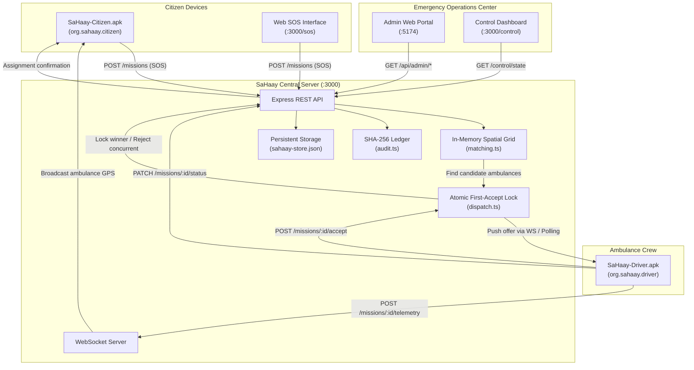

# SaHaay-2k26 — Repository Inventory & Subsystem Mapping

This document provides an exhaustive, authoritative inventory of the **SaHaay-2k26** codebase as of Milestone 11 (October 2026). It distinguishes active production components, build infrastructure, shared packages, and archived legacy prototypes.

---

## 1. High-Level System Architecture & Directory Tree

```
SaHaay-2k26/
├── apps/                                  # Client Applications
│   ├── citizen-app/                       # Native Android APK: SaHaay Citizen (org.sahaay.citizen)
│   │   ├── AndroidManifest.xml            # Hardware permissions: GPS, Accelerometer, Vibrate, Net
│   │   ├── assets/                        # In-app native offline SPA (HTML5, Tailwind, JS)
│   │   ├── res/                           # Android values, themes, strings
│   │   └── src/org/sahaay/citizen/        # MainActivity.java, SaHaayCitizenBridge.java
│   ├── driver-app/                        # Native Android APK: SaHaay Driver (org.sahaay.driver)
│   │   ├── AndroidManifest.xml            # Hardware permissions: GPS, Vibrate, Network
│   │   ├── assets/                        # Driver mission SPA, radar dome, stage progression
│   │   ├── res/                           # Android values, themes, strings
│   │   └── src/org/sahaay/driver/         # MainActivity.java, SaHaayDriverBridge.java
│   └── admin-web/                         # Central Public Portal & Authenticated Control Room
│       ├── src/App.tsx                    # Multi-view Admin SPA (Vite + React + Tailwind)
│       └── package.json                   # Web app dependencies & build script
│
├── artifacts/                             # Production Outputs & Cryptographic Keys
│   ├── apk/                               # Signed release APK binaries & idsig files
│   │   ├── SaHaay-Citizen.apk             # Android package: org.sahaay.citizen
│   │   └── SaHaay-Driver.apk              # Android package: org.sahaay.driver
│   └── sahaay-release-key.jks             # Production release keystore (RSA 2048)
│
├── assets/                                # Geo & Spatial Data Assets
│   ├── gazetteer.json                     # ~200 Ahmedabad localities & Base36 coordinate hints
│   └── ahmedabad-roads.geojson            # SYNTHETIC road network geometry for Dead-Reckoning
│
├── design-references/                     # Visual Source of Truth (READ-ONLY)
│   └── stitch_sahaay/                     # Official Stitch exports & DESIGN.md tokens
│       ├── 01_shared_design_system/       # Token specifications, colors, elevation, typography
│       ├── 02_citizen_tracking/           # Reference code & mock for route tracking
│       ├── 03_citizen_sos/                # Reference code & mock for 112/SOS plate
│       ├── 04_driver_dispatch/            # Repurposed for Citizen Updates & Advisories Feed
│       ├── 05_visual_reference_social_ui/ # Reference for Citizen Home UI composition
│       └── 06_visual_reference_dark_explore_ui/ # Reference for Driver Home UI composition
│
├── docs/                                  # System Architecture, Audit & QA Documentation
│   ├── ARCHITECTURE.md                    # Core architecture & design reference mapping
│   ├── API.md                             # REST & WebSocket endpoint contracts
│   ├── BENCHMARK.md                       # Empirical dispatch latency measurement ($p99 < 0.02ms$)
│   ├── CLAIMS_MATRIX.md                   # Verifiable claims vs implementation evidence
│   ├── CONFIGURATION_REFERENCE.md         # Environment variables & runtime constants
│   ├── DEPLOYMENT.md                      # Operational guide for local, Docker, & Android
│   ├── HANDOFF.md                         # Milestone ledger & sprint handoff state
│   ├── LIMITATIONS.md                     # Honest engineering boundaries & offline constraints
│   ├── REPOSITORY_INVENTORY.md            # (This document)
│   ├── SECURITY_REVIEW.md                 # Security analysis, role boundaries, and threat model
│   ├── TEST_CASES.md                      # Comprehensive test matrix and edge cases
│   └── TEST_REPORT.md                     # Automated test execution reports
│
├── mobile-app/                            # Responsive Browser Simulator & Web Testing Suite
│   ├── src/App.tsx                        # Dual-role preview switcher (Citizen / Driver)
│   └── vite.config.ts                     # Dev server configuration (Port 5173)
│
├── packages/                              # Shared Domain Models & Constants
│   ├── shared-types/index.ts              # Unified TypeScript interfaces across clients/server
│   └── shared-config/index.ts             # Ahmedabad coordinate bounding boxes & design tokens
│
├── scripts/                               # Automation & Build Tooling
│   ├── build-apk.ps1                      # 6-step AAPT2/Javac/D8/Apksigner Android build chain
│   ├── emu.sh                             # Linux/macOS emulator launch helper
│   └── smoke-test.js                      # Automated HTTP health & dispatch test
│
├── server/                                # Authoritative Dispatch Server
│   ├── data/sahaay-store.json             # File-backed persistence (citizens, drivers, news, releases)
│   ├── src/index.ts                       # Express + WebSocket HTTP server entrypoint
│   ├── src/routes.ts                      # REST routes (missions, auth, admin, news, telemetry)
│   ├── src/auth.ts                        # Role-based auth & driver license verification gate
│   ├── src/storage.ts                     # Persistence service layer
│   ├── src/dispatch.ts                    # Atomic first-accept lock & ripple expansion ladder
│   ├── src/matching.ts                    # In-memory spatial grid index
│   ├── src/audit.ts                       # SHA-256 tamper-evident hash chain ledger
│   └── src/ws.ts                          # Real-time WebSocket pub/sub
│
├── src/core/                              # Pure TypeScript Offline Domain Logic (Tested)
│   ├── config.ts                          # Single source of truth for tunable parameters
│   ├── sosCodec.ts                        # 4-byte Base36 compact SMS codec with CRC-8
│   ├── crash/CrashDetector.ts             # 2.5g impact trigger + 1000ms stillness filter
│   ├── crash/CountdownTimer.ts            # 30-second cancellation timer (guaranteed exactly-once)
│   ├── tracking/DeadReckoningTracker.ts   # Turf.js spline interpolation + exponential smoothing
│   └── transport/TransportManager.ts      # 4-state transport reducer (ONLINE/DEGRADED/SMS/RECOVERED)
│
└── [Legacy / Pre-Sprint Prototypes]       # Retained for hackathon history; not part of active runtime
    ├── backend/                           # Legacy MongoDB backend from preliminary hackathon concept
    ├── frontend/                          # Legacy multi-package frontend scripts
    ├── HSC Docs and Output/               # Early draft hackathon documentation submissions
    └── stitch_sahaay_emergency_mobile_app/# Duplicate archive extraction (preserved read-only)
```

---

## 2. Directory Purpose & Lifecycle Classification

| Directory | Classification | Active Role in Ecosystem | Notes |
|:---|:---|:---|:---|
| `apps/citizen-app/` | **ACTIVE (PRIMARY)** | Compiles to `SaHaay-Citizen.apk`. Implements citizen SOS, impact monitoring, live route tracking, and news feed. | Native Android app. Built via `scripts/build-apk.ps1`. |
| `apps/driver-app/` | **ACTIVE (PRIMARY)** | Compiles to `SaHaay-Driver.apk`. Implements paramedic duty radar, verification gate, atomic mission acceptance, and navigation. | Native Android app. Built via `scripts/build-apk.ps1`. |
| `apps/admin-web/` | **ACTIVE (PRIMARY)** | Central web portal: public APK download pages + authenticated control room (fleet, driver verification, news CMS). | React + Vite + Tailwind. Built via `cd apps/admin-web && npm run build`. |
| `server/` | **ACTIVE (PRIMARY)** | Authoritative dispatch engine, WebSocket broadcast, REST API, persistence store, and SHA-256 audit ledger. | Express + WS on port 3000. Started via `npm run dev:server`. |
| `src/core/` | **ACTIVE (CORE)** | Pure algorithmic logic for Base36 encoding, crash detection, dead reckoning, and transport state transitions. | 100% test coverage with Jest (58/58 tests pass). |
| `packages/` | **ACTIVE (SHARED)** | Shared TypeScript interfaces and design tokens. | Shared across clients and backend. |
| `assets/` | **ACTIVE (DATA)** | Locality gazetteer (`gazetteer.json`) and synthetic road network (`ahmedabad-roads.geojson`). | Grounding data for Ahmedabad dispatch. |
| `artifacts/` | **ACTIVE (RELEASE)** | Release APK binaries, signatures, and keystore. | Output directory served statically by backend `/downloads`. |
| `scripts/` | **ACTIVE (DEVOPS)** | Android compilation scripts, CI smoke test, and emulator tools. | Core build scripts. |
| `mobile-app/` | **ACTIVE (DEV/QA)** | In-browser dual-experience simulator for testing on web without Android emulator. | Vite on port 5173. Started via `cd mobile-app && npm run dev`. |
| `design-references/`| **PROTECTED (TRUTH)**| Authoritative visual designs from Stitch. | **Read-only**. Do not modify or delete. |
| `backend/` | **LEGACY (ARCHIVED)** | Pre-sprint hackathon MongoDB/Express service. | Superseded by `server/`. Not used by active apps. |
| `frontend/` | **LEGACY (ARCHIVED)** | Pre-sprint multi-package web experiment. | Superseded by `apps/` and `mobile-app/`. |
| `HSC Docs and Output/` | **HISTORICAL** | Initial draft documents submitted during preliminary hackathon registration. | Retained for audit trail. |
| `stitch_sahaay_emergency_mobile_app/` | **REFERENCE (BACKUP)** | Duplicate unzipped folders of Stitch UI references. | Retained for safety; canonical is `design-references/`. |

---

## 3. Runtime Entry Points & Port Allocations

| Component | Technology | Entry Point File | Default URL / Port | Command |
|:---|:---|:---|:---|:---|
| **Authoritative Backend** | Node.js / Express / WS | `server/src/index.ts` | `http://localhost:3000` | `npm run dev:server` |
| **Control Room (Static)** | Vanilla HTML / JS | `server/src/control.html` | `http://localhost:3000/control` | Auto-served by backend |
| **Citizen SOS (Static)** | Vanilla HTML / JS | `server/src/sos.html` | `http://localhost:3000/sos` | Auto-served by backend |
| **Admin Web Portal** | React / Vite | `apps/admin-web/src/main.tsx`| `http://localhost:5174` | `cd apps/admin-web && npm run dev` |
| **Mobile Browser Sim** | React / Vite | `mobile-app/src/main.tsx` | `http://localhost:5173` | `cd mobile-app && npm run dev` |
| **Citizen Native APK** | Android Native (API 34)| `org.sahaay.citizen.MainActivity` | Native App (`org.sahaay.citizen`) | Built with `scripts/build-apk.ps1` |
| **Driver Native APK** | Android Native (API 34)| `org.sahaay.driver.MainActivity` | Native App (`org.sahaay.driver`) | Built with `scripts/build-apk.ps1` |

---

## 4. End-to-End Data Flow



---

## 5. Build, Test & CI Automation

1. **Unit & Integration Tests**:
   - Command: `npm test`
   - Scope: `src/core/` and `server/src/`
   - Framework: Jest + ts-jest (58 automated test cases, 7 suites).
2. **Type Check**:
   - Command: `npm run typecheck`
   - Scope: Root TypeScript config + Server TypeScript config (`tsc --noEmit`).
3. **Android APK Compilation**:
   - Command: `powershell -ExecutionPolicy Bypass -File scripts/build-apk.ps1`
   - Toolchain: Android Build-Tools 34.0.0, AAPT2, Java 8 Javac, D8, Zipalign, Apksigner.
   - Result: Self-contained signed release APKs in `artifacts/apk/`.
4. **Admin Web Compilation**:
   - Command: `cd apps/admin-web && npm run build`
   - Result: Production SPA bundle in `apps/admin-web/dist/`.
5. **Continuous Integration**:
   - File: `.github/workflows/sahaay-ci.yml`
   - Actions: Installs dependencies, runs TypeScript checks, executes 58 Jest tests, runs smoke test.

