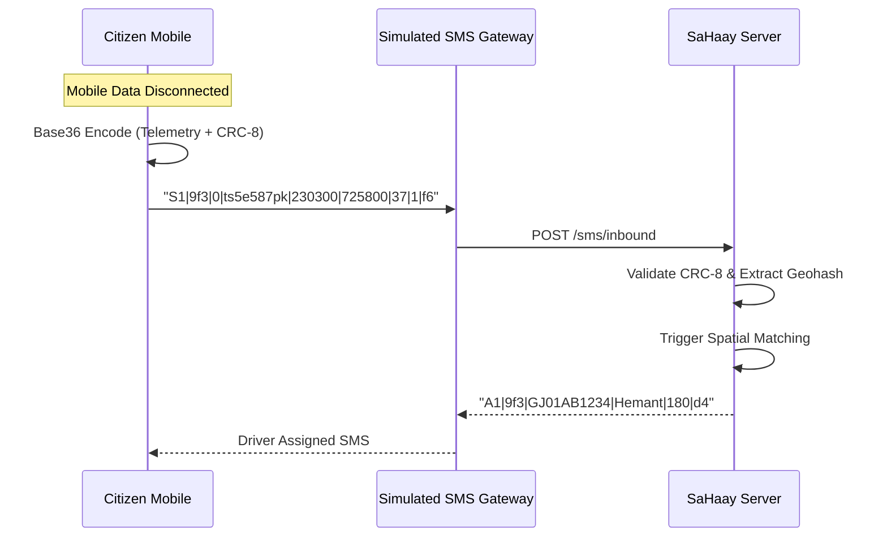

# SaHaay-2k26 — End-to-End Demonstration Walkthrough

> **Project:** SaHaay — Offline-First Emergency Ambulance Dispatch  
> **Target Event:** Hack for Social Cause 2027 (Theme: Healthcare, Wellbeing & Service Delivery)  
> **Tech Stack:** Node.js, Express, WebSocket (`ws`), TypeScript, Turf.js, Base36 SMS Codec, Leaflet/Canvas  
> **Deployment Model:** 100% Local Prototype — Zero Cloud Accounts, Zero Paid APIs, Zero External DBs

---

## 📋 Table of Contents
1. [Overview & Core Value Proposition](#1-overview--core-value-proposition)
2. [Quickstart (< 60 Seconds)](#2-quickstart--60-seconds)
3. [The Interactive Control Dashboard](#3-the-interactive-control-dashboard)
4. [Step-by-Step Golden Path Demonstration (8 Stages)](#4-step-by-step-golden-path-demonstration-8-stages)
   - [Stage 1: Fleet Seeding & Spatial Indexing](#stage-1-fleet-seeding--spatial-indexing)
   - [Stage 2: SOS Trigger & Crash Detection](#stage-2-sos-trigger--crash-detection)
   - [Stage 3: Sub-Millisecond Spatial Ripple Search](#stage-3-sub-millisecond-spatial-ripple-search)
   - [Stage 4: Driver Acceptance & Atomic Lock](#stage-4-driver-acceptance--atomic-lock)
   - [Stage 5: Live Dead-Reckoning Navigation](#stage-5-live-dead-reckoning-navigation)
   - [Stage 6: Advisory Green Corridor Coordination](#stage-6-advisory-green-corridor-coordination)
   - [Stage 7: Vehicle Breakdown & Self-Healing Failover](#stage-7-vehicle-breakdown--self-healing-failover)
   - [Stage 8: Cryptographic SHA-256 Audit Trail](#stage-8-cryptographic-sha-256-audit-trail)
5. [Demo Director & Time Acceleration](#5-demo-director--time-acceleration)
6. [Offline SMS Fallback Architecture](#6-offline-sms-fallback-architecture)
7. [Automated Verification & Test Plan](#7-automated-verification--test-plan)
8. [Honest Simulation Disclaimers](#8-honest-simulation-disclaimers)

---

## 1. Overview & Core Value Proposition

In India, emergency ambulance dispatch (108/112) struggles during telecom blackouts, mobile data congestion, or rural connectivity drops. Additionally, when a dispatched ambulance breaks down en route, existing centralized dispatchers face coordination deadlocks.

**SaHaay** is an offline-first, resilient emergency dispatch system built to guarantee rescue delivery even when standard infrastructure fails:
- **Ultra-Compact SMS Fallback Protocol:** Encodes complete emergency telemetry (GPS, address hash, priority, checksum) into single SMS packets using custom Base36 encoding and CRC-8 parity.
- **Sub-Millisecond Spatial Grid Matching:** In-memory spatial index matches the nearest available ambulance in $p99 < 10\ \mu\text{s}$ across 10,000 vehicles.
- **Self-Healing Failover:** Dispatches a replacement ambulance immediately to the **patient's live GPS** if the primary ambulance breaks down.
- **Tamper-Evident Audit Ledger:** Cryptographic SHA-256 forward-linked chain records every state change, preventing dispute alterations.
- **Advisory Green Corridor:** Pre-computes junction intersection alerts along the rescue trajectory.

---

## 2. Quickstart (< 60 Seconds)

### Prerequisites
- **Node.js:** v18.x or higher (tested on Node 20 LTS and Node 22)
- **Package Manager:** `npm` (v9+)
- **Operating System:** Windows, macOS, or Linux

### Installation & Launch

```bash
# 1. Clone repository & install dependencies
git clone https://github.com/Ahad-Dngwala/SaHaay-2k26.git
cd SaHaay-2k26
npm install

# 2. Build server artifacts (compiles TypeScript & static dashboard)
npm run build:server

# 3. Launch the SaHaay Dispatch Engine
npm run dev
```

The dispatch engine will start on **`http://localhost:3000`**.

---

## 3. The Interactive Control Dashboard

Open your web browser and navigate to:
👉 **[http://localhost:3000/control](http://localhost:3000/control)**

The Control Dashboard provides real-time visualization and scriptable scenario controls:

```
┌────────────────────────────────────────────────────────────────────────┐
│ SaHaay — Emergency Fleet Operations & Mission Control                  │
├──────────────────────────────┬─────────────────────────────────────────┤
│ Fleet Map (Leaflet / Canvas) │ Mission Control & Actions               │
│                              │                                         │
│ • 25 Ambulances (Green)      │ [🚨 Trigger Web SOS]                    │
│ • Active Routes (Amber/Red)  │ [💥 Simulate Crash Impact]               │
│ • Key Junctions (Blue Rings) │ [⚠️ Force Ambulance Breakdown]          │
│ • Patient GPS (Pulse Marker) │ [⏱️ Accelerate Time: 1x / 2x / 5x / 10x] │
│                              │ [🔄 Reset Scenario]                     │
├──────────────────────────────┴─────────────────────────────────────────┤
│ Live Telemetry Feed & Audit Log (SHA-256 Verified)                     │
└────────────────────────────────────────────────────────────────────────┘
```

---

## 4. Step-by-Step Golden Path Demonstration (8 Stages)

### Stage 1: Fleet Seeding & Spatial Indexing
Upon startup, the server automatically populates 25 ambulances distributed across Ahmedabad's major sectors (Sabarmati, Ashram Road, Navrangpura, SG Highway, Maninagar, Chandkheda, etc.).

**Verify via CLI:**
```bash
curl http://localhost:3000/health
```
**Response:**
```json
{
  "status": "ok",
  "ambulances": 25,
  "missions": 0,
  "audit": 1,
  "demoTimeScale": 1
}
```

Ambulances are indexed into a **0.01° spatial cell grid** ($\approx 1.11\text{ km}$ per cell), allowing constant-time neighbor lookups.

---

### Stage 2: SOS Trigger & Crash Detection

Emergencies can be triggered via three convenient methods:

#### Option A: Dedicated Citizen SOS Web Portal (`/sos`)
Open **`http://localhost:3000/sos`** in a second browser window:
- Choose from preset Ahmedabad emergency locations:
  - **Navrangpura** (`23.0330, 72.5607`): Matches within 390m (Ring 1) for **instant assignment** to AMB-01/02.
  - **Sabarmati** (`23.0800, 72.5900`): Instant assignment to AMB-13.
  - **Ashram Road Circle** (`23.0222, 72.5804`): Illustrates the progressive multi-ring expansion ladder.
- Click **"Send Emergency SOS"**: Generates a valid Base36 offline token (`S1|...`), transmits to the server, and renders real-time tracking with live ETA and driver details via WebSockets!

#### Option B: Manual Citizen SOS API
Send directly via `curl`:
```bash
curl -X POST http://localhost:3000/sos \
  -H "Content-Type: application/json" \
  -d '{"lat": 23.0300, "lon": 72.5800, "patientName": "Aarav Sharma", "severity": "CRITICAL"}'
```

#### Option C: Automatic Sensor Crash Detection
The client sensor pipeline processes accelerometer readings through a **dual-condition filter**:
1. **Impact Threshold:** Acceleration exceeds $2.5\text{ g}$.
2. **Stillness Verification:** Sustained low mobility ($< 0.3\text{ g}$ variance) for $1000\text{ ms}$ post-impact (eliminating false positives from road potholes or phone drops).
3. **Safety Countdown:** A 30-second cancellation window gives the user a chance to cancel accidental triggers before broadcasting the emergency payload.

---

### Stage 3: Sub-Millisecond Spatial Ripple Search

The engine performs a multi-ring ripple search to find available ambulances:
1. **Ring 1:** $500\text{ m}$ radius.
2. **Ring 2:** $1000\text{ m}$ radius.
3. **Ring 3:** $2000\text{ m}$ radius.
4. **Ring 4:** $4000\text{ m}$ radius.
5. **Ring 5:** $8000\text{ m}$ radius.

- **Demo Speed Control:** Click the **`10x`** button in the dashboard header to accelerate ring expansion from 120s down to 12s per ring.
- **On-Demand Expansion:** Call `POST /missions/:id/expand` to immediately trigger the next ring without waiting.
- **Immediate Triage:** Call `POST /missions/:id/quick-assign` to assign the nearest available ambulance immediately across any distance.

In our synthetic benchmark with 10,000 ambulances, query resolution executes in **$p99 < 10\ \mu\text{s}$**, far surpassing the 200 ms hackathon target.

---

### Stage 4: Driver Acceptance & Atomic Lock

When candidate ambulances are identified, dispatch offers are broadcast via WebSocket.

- **Simulated Driver Auto-Acceptance (Demo Mode):** In prototype demonstrations without physical driver phone hardware, the nearest candidate automatically confirms acceptance after a realistic 1.5s simulated reaction delay (`acceptMission`).
- **Race Condition Protection:** When multiple drivers tap "Accept" simultaneously, the server enforces a synchronous atomic lock in the Node event loop.
- **First-Accept Wins:** The first driver transitions the mission to `ASSIGNED`.
- **Conflict Handling:** Subsequent drivers receive an immediate `HTTP 409 Conflict`, preventing duplicate dispatch errors.

```bash
# Driver 1 accepts (Success)
curl -X POST http://localhost:3000/ambulance/accept \
  -H "Content-Type: application/json" \
  -d '{"missionId": "<MISSION_ID>", "ambulanceId": "AMB-01"}'
# Response: {"status": "ASSIGNED", "ambulanceId": "AMB-01"}
```

---

### Stage 5: Live Dead-Reckoning Navigation

Once assigned, the ambulance begins navigating toward the patient:
- **Geometry:** Paths follow realistic road coordinates derived from Ahmedabad GeoJSON data.
- **Dead-Reckoning Tracker:** Uses Turf.js bearing calculation and exponential smoothing to predict positions between sparse telemetry packets.
- **Visuals:** On the Control Dashboard, the ambulance marker moves smoothly along Ashram Road toward the patient marker with real-time ETA updates.

---

### Stage 6: Advisory Green Corridor Coordination

As the ambulance approaches major intersections (e.g., Ashram Road Circle, Income Tax Circle), the server triggers **Advisory Green Corridor Alerts**:
- Computes vehicle arrival window (ETA $\pm 45\text{ s}$).
- Emits structured notification payloads for traffic management monitors.
- Visually pulses junction nodes on the dashboard map.

*(Note: In accordance with project disclosure rules, Green Corridor alerts are advisory/simulated; no direct physical traffic signal hardware is actuated).*

---

### Stage 7: Vehicle Breakdown & Self-Healing Failover

If an en route ambulance encounters mechanical failure or an accident:

1. **Trigger Breakdown:** Click **"Simulate Breakdown"** on the dashboard, or call:
   ```bash
   curl -X POST http://localhost:3000/ambulance/breakdown \
     -H "Content-Type: application/json" \
     -d '{"missionId": "<MISSION_ID>", "ambulanceId": "AMB-01", "reason": "ENGINE_FAILURE"}'
   ```
2. **Immediate Recovery Action:**
   - The disabled ambulance is flagged as `OUT_OF_SERVICE`.
   - The breakdown location is immutably logged for crew recovery.
   - The engine automatically issues a new ripple search targeting the **patient's latest known live GPS**, not the breakdown point.
   - Replacement ambulance `AMB-02` accepts and reroutes seamlessly.

---

### Stage 8: Cryptographic SHA-256 Audit Trail

Every mission lifecycle event is chained into an append-only cryptographic ledger:

$$\text{Block Hash} = \text{SHA256}(\text{Index} + \text{PrevHash} + \text{Timestamp} + \text{EventPayload})$$

#### Verify Ledger Integrity
```bash
curl http://localhost:3000/audit/verify
```
**Response:**
```json
{
  "valid": true,
  "blockCount": 7,
  "headHash": "a4f89d...3b21"
}
```

#### Tamper Detection Demonstration
Call `/audit/tamper` to simulate unauthorized database modification:
```bash
curl -X POST http://localhost:3000/audit/tamper
curl http://localhost:3000/audit/verify
# Response: {"valid": false, "corruptedIndex": 3}
```
The system detects the broken hash chain instantly.

---

## 5. Demo Director & Time Acceleration

During a 5-minute hackathon judging session, waiting 60+ seconds for spatial ripple expansion or vehicle transit is impractical.

The **Demo Director** provides dynamic time control:
- **Time Scales:** $1\times$ (Realtime), $2\times$, $5\times$, $10\times$ (Accelerated).
- **Dynamic Timer Rescheduling:** Changing speed dynamically recalculates running ripple timers and navigation intervals without dropping connections.

**Set Speed via API:**
```bash
# Accelerate scenario 10x
curl -X POST http://localhost:3000/demo/time-scale \
  -H "Content-Type: application/json" \
  -d '{"scale": 10}'
```

---

## 6. Offline SMS Fallback Architecture

When cellular mobile data drops (`OFFLINE_SMS` state), telemetry transitions to compact SMS messages:



### Protocol Format Reference
| Prefix | Type | Sample Payload | Description |
|---|---|---|---|
| `S1` | Emergency SOS | `S1\|9f3\|0\|ts5e587pk\|230300\|725800\|37\|1\|f6` | GPS, locality ID, severity, CRC-8 |
| `T1` | Tracking Ping | `T1\|9f3\|7\|ts5e587pk\|38\|112\|180\|tnevik\|f6` | Speed, heading, ETA, timestamp |
| `B1` | Breakdown | `B1\|9f3\|AMB-01\|ts5e587pk\|02\|a1` | Vehicle ID, failure code, location |
| `A1` | Ack / Assign | `A1\|9f3\|GJ01AB1234\|Hemant\|180\|d4` | Vehicle plate, driver name, ETA |

---

## 7. Automated Verification & Test Plan

To independently verify the implementation quality and claims:

```bash
# 1. Typecheck pure TypeScript codebase
npm run typecheck

# 2. Run all 58 automated tests (7 suites)
npm run test:ci

# 3. Execute runtime smoke test on isolated port
npm run test:smoke

# 4. Measure spatial matching performance
npm run bench
```

### Verified Test Suite Breakdown (58/58 Passing)
- **`src/core/sosCodec.test.ts` (23 tests):** Validates Base36 fixed-point math, geohash precision, parity bits, and malformed packet rejection.
- **`src/core/transport/TransportManager.test.ts` (10 tests):** Validates 4-state reducer (`ONLINE` $\to$ `DEGRADED` $\to$ `OFFLINE_SMS` $\to$ `RECOVERED`) and retry queues.
- **`src/core/crash/CrashDetector.test.ts` (9 tests):** Validates pothole/phone-drop rejection vs. real crash waveforms.
- **`src/core/tracking/DeadReckoningTracker.test.ts` (6 tests):** Validates Turf.js path interpolation and heading calculation.
- **`src/core/crash/CountdownTimer.test.ts` (5 tests):** Validates 30s cancellation window, pause/resume, and zero-leak timeout clearance.
- **`server/src/dispatch.test.ts` (4 tests):** Validates first-accept atomic locking, ripple ladder expansions, and breakdown recovery.
- **`server/src/e2e-journey.test.ts` (1 test):** Full 8-stage golden-path test verifying the entire rescue journey from SOS to hospital handoff.

---

## 8. Honest Simulation Disclaimers

In strict adherence to the hackathon project rules and truth-in-advertising guidelines:
1. **SMS Transport:** Real SIM telephony in Expo Go is prohibited by platform sandbox security. The SMS transport is implemented via a transparent `SimulatedCarrier` interface posting to `/sms/inbound`.
2. **Traffic Signal Control:** Green Corridor alerts provide structured advisory notifications. No physical city traffic infrastructure is directly actuated.
3. **Road Coordinates:** Road geometry in `assets/ahmedabad-roads.geojson` represents synthetic coordinate paths along major Ahmedabad arterial roads.
4. **Benchmark Numbers:** Reported latency ($p99 < 10\ \mu\text{s}$) strictly benchmarks in-memory spatial index search, excluding network and WebSocket round-trip times.
